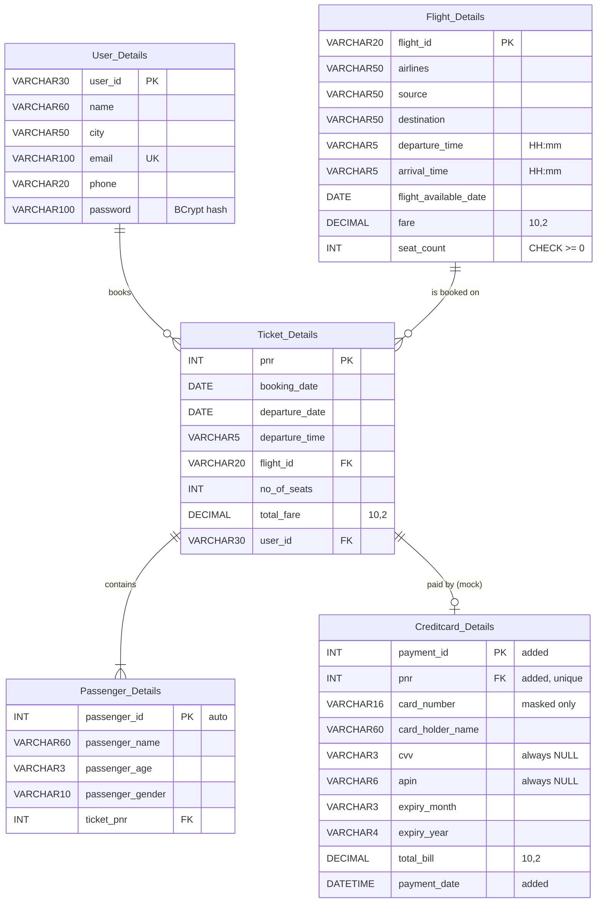

# ER diagram and schema

DDL: [`src/main/resources/db/migration/V1__create_infygo_schema.sql`](../src/main/resources/db/migration/V1__create_infygo_schema.sql).

## Differences from the supplied diagram (and why)

| Diagram | Implementation | Reason |
|---|---|---|
| `fare`, `total_fare`: Double; `total_bill`: String | `DECIMAL(10,2)` / `BigDecimal` | Exact money arithmetic. The API exposes them as JSON numbers. |
| Creditcard_Details has no key and no link to a ticket | Added `payment_id` (PK), `pnr` (FK, unique) and `payment_date` | A payment must refer to the ticket it pays for, and a masked card number cannot serve as a key. These are the smallest additions that make that possible. |
| `cvv`, `apin` stored | Columns kept, never written (NULL) | Storing card authentication data is unsafe even in a demo |
| `card_number` | Masked value `XXXXXXXXXXXX` + last 4 | Never store a full card number |
| Keys, constraints | PKs, FKs, unique e-mail, CHECK `seat_count >= 0`, index on (source, destination, date) | Integrity and search performance |

Field names, table names and the types of identifiers (`user_id`/`flight_id` String, `pnr`/`passenger_id`/`ticket_pnr` Integer, `passenger_age` String) follow the diagram as supplied. The brief mentions a sixth table that was not listed; see `PROJECT_REQUIREMENTS.md`.
